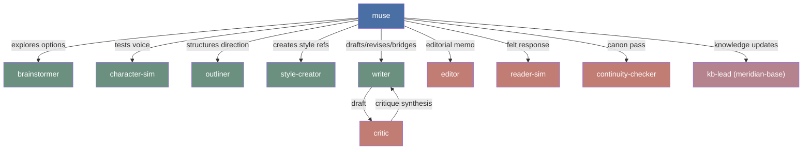
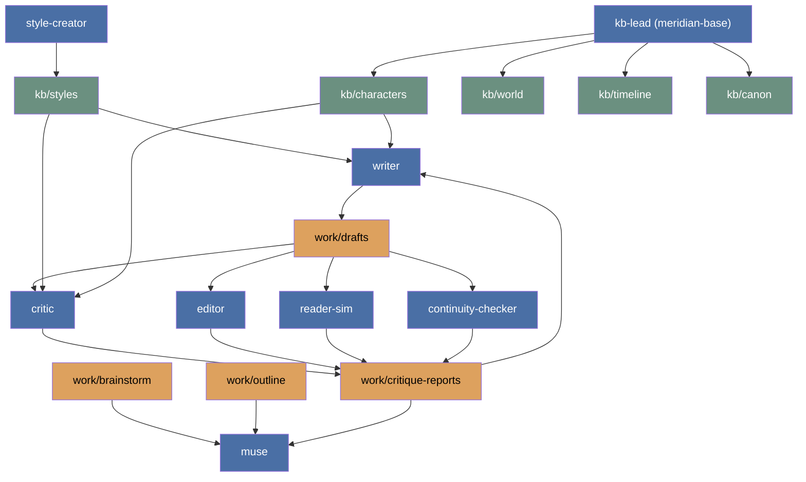

# Package Architecture

Creative-writing-skills uses a compact worker set backed by richer craft skills.
The product thesis is not many near-duplicate writer agents; it is a strong
muse, a few clean cognitive roles, durable story context, and intentional prose
methodology.

## Agent Shape



## Roles

| Agent | Role |
|---|---|
| muse | Author-facing creative partner and coordinator |
| writer | Production prose: fresh drafts, critique-driven revisions, bridges, connective passages, alternate takes, line polish |
| critic | Adversarial craft diagnosis with focused review areas |
| editor | Holistic third-party editorial memo and revision priority |
| reader-sim | Experiential reader response: what it felt like to read |
| continuity-checker | Cross-project canon and terminology contradiction pass |
| brainstormer | Divergent option generation before commitment |
| outliner | Arc/chapter/beat structure after direction is chosen |
| character-sim | In-character simulation and relationship exploration |
| style-creator | Style reference extraction from prose samples |
| kb-lead (meridian-base) | Story fact, timeline, canon, and terminology extraction into `kb/`, guided by the `story-memory` skill; muse applies the skill directly in harnesses without kb-lead |

## Draft Loop

The production loop is intentionally simple:

```text
muse → writer → critic/editor/reader-sim/continuity-checker → writer
```

`writer` owns all prose production modes. Keeping one prose worker preserves
voice continuity better than splitting fresh drafting, bridges, and revision
across separate agents. The stance still changes through the prompt: fresh
draft, surgical revision, bridge, polish, or alternate take.

`critic` stays separate because adversarial diagnosis benefits from fresh
context. `editor` stays separate because holistic editorial prioritization is
not the same mode as focused critique. `reader-sim` stays separate because
reader simulation is not the same mode as craft critique. `continuity-checker` stays separate when canon search
must be broader than the critic's provided context.

## Skill Layer

Skills carry the methodology that makes the smaller agent set work:

| Skill | Purpose |
|---|---|
| creative-writing-modes | Pen-on-paper prose execution modes |
| creative-writing-craft | How-to-write craft library for prose, scenes, style, and genre technique |
| writing-principles | Reader reward channels and AI fiction failure modes |
| story-planning | Direction, brainstorming, outlining, and architecture before drafting |
| story-review | Editorial review, developmental edit, line edit, copyedit, proofreading, critique, and reader-signal synthesis |
| story-memory | Context selection, fact extraction, reference writing, artifacts, and issues |
| reader-sim | Persona-bound first-time reader simulation |
| character-sim | In-character simulation for voice and relationship exploration |
| writing-staffing | Compose compact teams and critic panels |
| llm-writing | Intentional language discipline for fiction and nonfiction artifacts |
| shared-dao | Canonical terminology and vocabulary discipline |

`llm-writing` does not replace prose craft. It catches unchosen defaults:
filler structure, vague language that hides lack of choice, polished transitions
that smooth away tension, and explanation that tells the reader what the scene
should make them feel. In fiction, ambiguity, omission, repetition, and broken
rhythm remain valid when they create the intended effect.

## Artifact Flow



## Google Antigravity 2.0 Multi-Agent Runtime Architecture

In Google Antigravity 2.0, the multi-agent system runs natively via the `invoke_subagent` and `send_message` protocols.

### 1. Hub-and-Spoke Topology

```mermaid
graph TD
    Author([Author]) <--> Muse["muse (Main Agent / Orchestrator)
    model: inherit"]

    subgraph EntryAgents ["Standalone Entry Agents (model: flash)"]
        Writer["writer"]
        CharSim["character-sim"]
        Outliner["outliner"]
    end

    subgraph ReviewPanel ["Review & Analysis Panel (model: flash, read-only)"]
        Critic["critic"]
        ReaderSim["reader-sim"]
        Continuity["continuity-checker"]
        ColdReader["cold-reader"]
        Explorer["explorer"]
        SessionMiner["session-miner"]
    end

    subgraph ProductionLanes ["Ideation & Production (model: flash)"]
        Brainstormer["brainstormer"]
        StyleCreator["style-creator"]
        Researcher["creative-researcher"]
    end

    subgraph KnowledgeCapture ["Knowledge Hierarchy (model: flash)"]
        KBLead["kb-lead"] --> KBMaintainer["kb-maintainer"]
        KBLead --> Explorer
        KBLead --> SessionMiner
        KBLead --> ColdReader
    end

    Muse -->|invoke_subagent| EntryAgents
    Muse -->|invoke_subagent (parallel)| ReviewPanel
    Muse -->|invoke_subagent| ProductionLanes
    Muse -->|hand-off when settled| KBLead
```

### 2. Model Tier Policy & Role Specialization
- **Primary Orchestrator (`muse`)**: `model: inherit`. Inherits the primary model chosen by the author in the Antigravity Desktop App or CLI.
- **Specialized Subagents (14 agents)**: All configured to `model: flash` (Gemini 3.8 Flash). Rather than relying on cross-vendor model fan-out, role diversity and depth are achieved through:
  - **Prompt Stances**: Explicit system prompt constraints (e.g. read-only reviewers, caller-reporting subagents).
  - **Modular Skill Sets**: Each agent loads only its designated craft skills (e.g. `critic` loads `story-review`, `continuity-checker` loads `story-memory` + `md-validation`).
  - **Context Isolation**: Each lane evaluates drafts in an unpolluted, independent context window.

### 3. Native Orchestration Patterns
- **Parallel Lane Fan-Out**: In `invoke_subagent`, `muse` dispatches multiple subagent definitions in a single call (e.g. `critic` for craft analysis, `reader-sim` for experiential reactions, and `continuity-checker` for canon verification) to evaluate a draft concurrently.
- **Stateful Multi-Turn Revisions**: `writer` retains context while idle. `muse` sends round-2 revision feedback to the active `writer` instance using `send_message`, maintaining stylistic consistency across iterative drafts.
- **Cold-Read Isolation**: Reviewers (`critic`, `reader-sim`) are spawned afresh per round, ensuring they evaluate drafts as naive readers without anchor bias from earlier drafting turns.
- **Nested Delegation**: When story changes settle, `muse` delegates knowledge base capture to `kb-lead`, which in turn orchestrates `explorer`, `session-miner`, `cold-reader`, and `kb-maintainer`.

### 4. Safety & Rules Integration
- **PreToolUse Safety Guard**: `hooks.json` intercepts `run_command` via `scripts/git_guard.py` (`0755`), preventing destructive git operations (`reset --hard`, `clean`, `restore`, `checkout --`, `revert`) by returning `{"decision": "ask"}`.
- **Dynamic Rules**: `rules/story-project.md` activates on `model_decision` when working with creative projects; `rules/kb-pages.md` activates on `glob` (`kb/**/*.md`, `work/**/*.md`) to enforce link integrity and frontmatter cleanliness.

